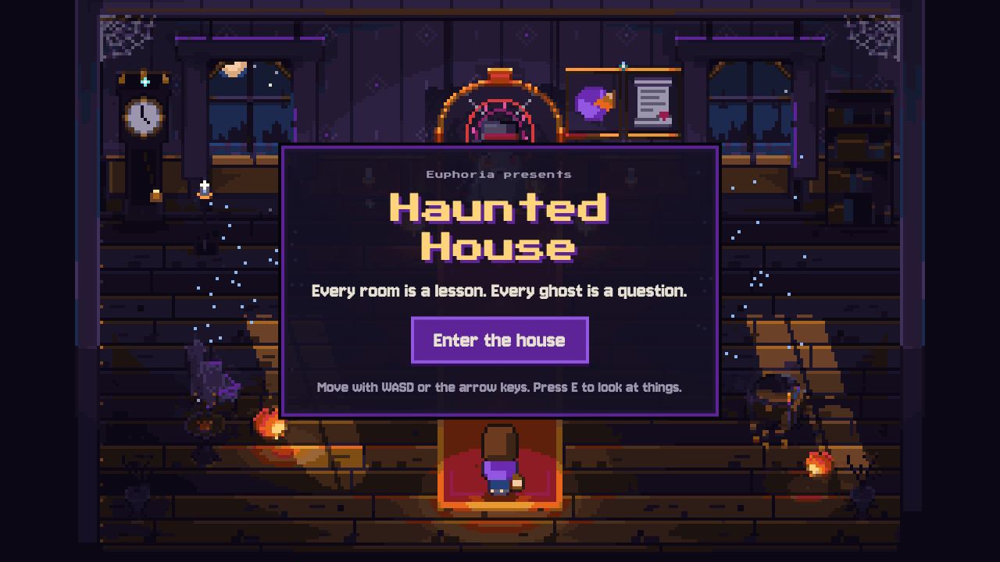
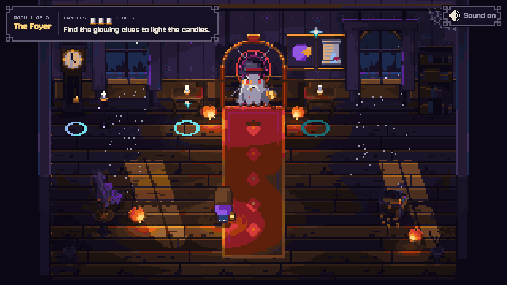
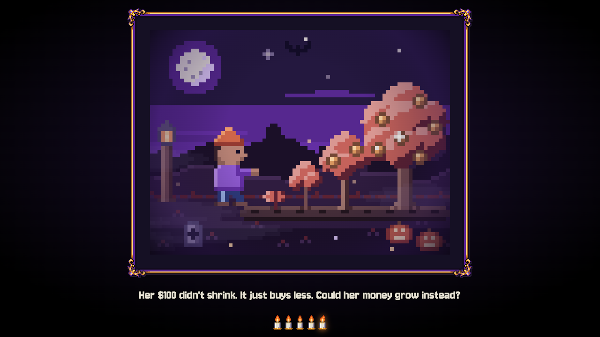
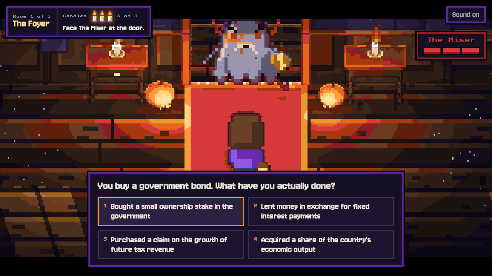
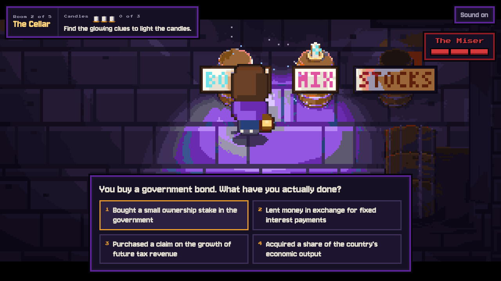

# Euphoria Haunted House

**Investing feels scary. So we made it literally scary, then made it make sense.**

A haunted 3D pixel-art house you explore with a lantern. Every room is a real investing lesson from [Euphoria](https://euphoriainv.com), the investing app for teens. Find what each ghost left behind, watch the memories, then answer the ghost's questions to set it free.

[**Play it in your browser**](https://euphoria-haunted-house.vercel.app) · Built for [Kiroween 2026](https://kiroween.devpost.com), Costume Contest category · MIT licensed



## How a room plays

1. **Explore.** Walk the dark room with your lantern. Moonlight falls through the windows and jack-o'-lanterns flicker.
2. **Find three clues.** Each glowing wisp marks something the ghost left behind. Look at it and a short fullscreen pixel movie plays the lesson. Then one of the room's three candles lights.
3. **Face the ghost.** With all three candles lit, the ghost will face you. Answer its questions. Every right answer drains its unrest. A wrong answer makes the room flicker, and the ghost explains why before asking again.
4. **Set it free.** The ghost thanks you and rises away, warm light fills the room, and the door to the next room unseals.

| Exploring the Foyer | A clue's movie |
| --- | --- |
|  |  |
| **Facing the Miser** | **The Cellar** |
|  |  |

## The rooms

| Room | Lesson | Ghost | Status |
| --- | --- | --- | --- |
| 1. The Foyer | Introduction to Investing | The Miser, who hid every dollar in a drawer | Playable |
| 2. The Cellar | Risk vs. Reward | The Gambler, who bet everything on one stock | Playable |
| 3. The Clock Tower | The Magic of Compound Interest | The Clockmaker, who always meant to start tomorrow | Playable |
| 4. The Portrait Gallery | Stocks vs. Bonds | The Duchess, who never learned who gets paid first | Playable |
| 5. The Kitchen | Diversification | The Cook, who carried every egg in one basket | Playable |

## Why the spooky design does a job

The Costume Contest asks for spooky design that improves the app. Every haunted effect here carries information:

- **Light is progress.** Each room starts dark, and each lesson you learn lights a candle. The HUD and the room both show it.
- **The ghost's mood is feedback.** Restless and red-eyed when you arrive, calm after a right answer, glowing when freed.
- **Wrong answers teach.** The room flickers, the ghost explains the mistake in the lesson's own words, and the question comes back.
- **Dread guides you.** The drone deepens and the edges of the screen darken as you near a restless ghost.

## Run it locally

```bash
npm install
npm run dev        # then open http://localhost:5173
npm run build      # typecheck and production build
```

Controls: WASD or the arrow keys to move. E, Space or Enter to look at things and advance text. 1 to 4 to answer. On a phone, drag on the left side of the screen to move and tap the button to act. The game respects reduced motion: it turns off shake, flicker and animation.

## How it is made

- **A 3D scene drawn as pixel art.** `src/game/pipeline.ts` renders the scene at a low resolution with toon shading, then a composite pass adds outlines, moonlit rim light, contact shadows and a violet and warm colour grade. It snaps every pixel to one Halloween palette. The orthographic camera is tilted to a 3-4-5 angle and snapped to the pixel grid, so textures show one texel per screen pixel and nothing shimmers.
- **Characters are 2D sprites in the 3D world.** They always face the camera and snap to pixels (`src/game/billboard.ts`).
- **Rooms are data.** Each room is a 3D build (`src/game/foyer.ts`, `cellar.ts`, `clocktower.ts`) plus a script (`foyer-script.ts`, `cellar-script.ts`, `clocktower-script.ts`) naming its ghost, lines, questions and movies. `src/game/rooms.ts` lists them in order.
- **The movies are Euphoria's own story lessons in costume.** `src/ui/movie.ts` plays them on Euphoria's story engine. `src/game/halloween.ts` turns summer into autumn and adds bats, jack-o'-lanterns, gravestones, cobwebs and fog.
- **Every lesson word is Euphoria's.** Questions, options and explanations are read straight from the lesson content (`src/game/lesson.ts`). Only the haunted framing is new writing.
- **All art is text.** Sprites are ASCII rows plus a palette, generated by the scripts in `scripts/art/`. Every sprite passes through a pixel-art fixer (`scripts/art/fixer.py`) that checks the grid, removes stray pixels and adds a moonlit edge.
- **All sound is synthesised.** The drone, wind, clock, footsteps and the music-box score are generated live with the Web Audio API, so there are no audio files and no licensed music.

## Reused from Euphoria

This project is new for Kiroween 2026, but it reuses existing code and content from Euphoria, an investing app built by the same team before the hackathon. Everything listed here existed before October 30, 2026, except the two Tiny Why items, which were written in November 2026 for a different project.

| What | Where it is here | Where it came from |
| --- | --- | --- |
| Pixel art engine: sprite format, compiler, SVG renderer, editor logic, source writer | `src/lib/pixel/types.ts`, `compile.ts`, `svg.ts`, `palette.ts`, `PixelSprite.tsx`, `edit.ts`, `source.ts` | Euphoria web app, `src/lib/pixel/`, written July to November 2026 |
| Sprite helpers `s`, `shade`, `withRows` | `src/lib/pixel/helpers.ts` | Euphoria web app, `src/lib/pixel/sprites.ts` |
| Lesson content: Investing Fundamentals lessons 1 to 5 | `content/euphoria/investing-fundamentals-1-5.json` | Euphoria web app, `src/features/pathway/courses/investingFundamentals.ts`, exported to JSON |
| Story movie engine (timing, carry-over glides, label and caption swaps) | `src/lib/pixel/story/engine.ts`, `types.ts` | Euphoria web app, `src/lib/pixel/story/` (branch story-lessons), itself a port of the iPhone app's story player |
| Story art and cards for lessons 1 to 5 | `content/euphoria/if1-story.json` to `if5-story.json` | Euphoria web app, `src/features/pathway/story/lessons/`, exported to JSON |
| Pixel-art fixer passes (`true_res` grid recovery, `despeckle`, `rim_light`, `palettize`) | `scripts/art/fixer.py` | Tiny Why, Sriyan's video project, `channel/scripts/art/pixelpaint.py` |
| 3D pixel-art renderer (low-res toon render, outline and palette-snap composite) | `src/game/pipeline.ts` | Tiny Why, `studio/src/pixel3d/pipeline.ts`, which credits three.js RenderPixelatedPass (MIT) and the Project Shadowglass write-ups |

Changes made to reused files: `compile.ts` now defaults to the haunted palette. `pipeline.ts` is orthographic only, follows the window size, adds encounter effects (flash, exposure, vignette), and fixes a bug where outlines between two objects never drew. Every reused file says where it came from in its header comment.

## New for Kiroween 2026

Everything not listed above, including the haunted palette, the 3D rooms, every ghost and haunted sprite, the movie player and the Halloween costume for the story scenes, the encounter, the room-to-room flow and saving, the shaped 3D props, the synthesised sound, the art generators, and the Kiro steering docs in `.kiro/`.

## How it was built

The starting setup (the engine import, the lesson export, this README and the first steering docs) was prepared with Claude Code on November 27, 2026. Rooms 1 to 5 (the Foyer, the Cellar, the Clock Tower, the Portrait Gallery and the Kitchen), the multi-room flow and the art fixer pass were also built with Claude Code that day. The `.kiro/` folder holds the project's steering docs, which describe the product, the stack, the structure and the pixel-art rules.

## License

MIT. See [LICENSE](LICENSE). Third-party assets, if any, keep their own licenses, listed in `assets/third-party/*/SOURCE.md`.
